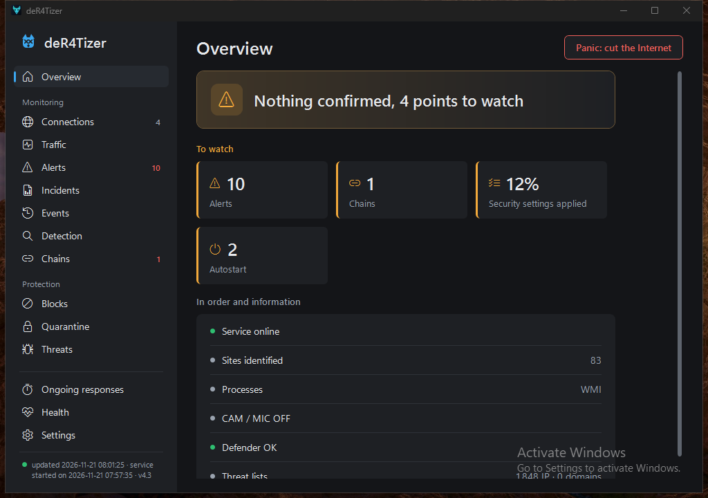
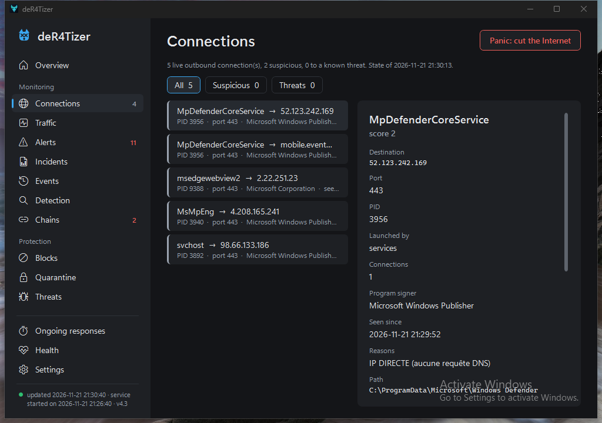

# deR4Tizer

**Local endpoint defense for Windows: EDR-style detection, a mini-SIEM and hardening; no cloud, no telemetry.**

> ⚠️ **Proof of concept.** Under active development, not audited. Does not replace an antivirus or a commercial EDR.
>
> The interface is bilingual (English / French); this README and the project site are in English.

---


### Why

deR4Tizer targets organisations with neither a SOC nor an EDR budget: small municipalities, micro-businesses, craftspeople, shops. Everything runs **on the endpoint**, with no account, no cloud and no telemetry. Critical alerts reach the IT provider or contact person (ntfy, Teams, e-mail) and can also go to the SIEM of your choice.

### Screenshots

Real screenshots of the interface (v4.3), taken in the test VM: Windows 11, Microsoft Defender on, service installed
from the MSI and left running for a few minutes. No data from a real computer.





### Features (v4.3)

Actual state of each capability (validated on Windows by the CI, checked in a test VM, lab-tested, or implemented without verification; the CI was disabled from 2026-10-22 to 2026-11-17):
[capability matrix](docs/roadmap/capability-matrix.md) (in French). None is production-ready yet; NDR, DPI and
IDS/IPS are experimental and under validation in the Kali lab campaign (reports in [docs/validation/](docs/validation/),
in French).

| Area | What deR4Tizer does |
|---|---|
| **Network** | Live outbound connections per program, suspicion score, beaconing detection, first Internet connection of a program |
| **Threat intelligence** | Open-source lists refreshed every 12 h (the two Spamhaus DROP lists every 24 h, as Spamhaus asks); automatic firewall blocking, on by default and can be turned off, for three lists only: Spamhaus DROP IPv4, Spamhaus DROP IPv6 and Feodo Tracker, at most 30 per hour; other lists only raise an alert |
| **Processes** | Process tree with cumulative chain score, obfuscated PowerShell, MITRE ATT&CK techniques |
| **Persistence** | Run keys, services, scheduled tasks, WMI, Startup folders: alert on any new or changed entry |
| **Ransomware** | Canary files, automatic suspension of the program touching them; alert only if it is known, signed software with its exact name, installed in a folder that only SYSTEM, Administrators, TrustedInstaller or services can write to or own (permissions checked) and running as SYSTEM or an elevated administrator, if an administrator resumed it (7 days, same file), or after 3 suspensions in 24 h of such a signed program installed in Program Files (script hosts excluded). Sync clients running under the user's account (OneDrive, Dropbox, Box), and software whose folder is owned by the account that installed it, are suspended if they touch a canary file |
| **Data theft** | Access auditing on sensitive browser and application folders |
| **Privacy** | Camera, microphone, remote-control tools, open ports |
| **Firewall** | Rule-change tracking (with the authoring program), Internet exposure (inbound packets from public IPs); when no exposure is found, each check is reported as seen or not checked (packet log off, UPnP not checked: "checks incomplete"), never "no exposure"; per-check diagnostic (public IPv4, global IPv6, accepted connections, blocked sources, UPnP, Windows Firewall) and a verdict: "computer exposed" (red) only for proven exposure, "exposure to watch" (orange, e.g. a global IPv6 address alone), "nothing found" or "checks incomplete", never "protected" |
| **Hardening** | Baseline inspired by Intune and Microsoft, applied through local Group Policy, reversible; a Defender rule counts as compliant only when Defender actually applies it ("no effect" when Defender is not the active antivirus or applies another value); side effects (Remote Desktop, UAC prompts, guest shares) are stated before applying, and the full profile leaves Remote Desktop on when it is in use; LSA protection without the UEFI lock (Windows 11 22H2 or later), so it stays reversible; event logs are never shrunk; reverting restores the original values, checked rule by rule in a test VM (60 rules) |
| **Response** | Kill, suspend, network-isolate (on the program's real path; a link, junction or mount point in the path is refused, and the administrator gives the real path), quarantine, PANIC button (cuts Internet, set in full or not at all, real state checked on the firewall); process identity re-checked just before the action; a suspension, an isolation or panic mode are never lifted automatically, but raised again to the IT provider at their deadline, as are a quarantine (30 days) and a manual block (90 days); automatic actions go through a loop guard that never holds back the alert, and an address unblocked by hand is not blocked again for 7 days |
| **Mini-SIEM** | Normalised events (logons, accounts, groups, processes, services, connections, firewall, alerts) kept 30 days, search, timeline, correlation incidents (brute force, logon after failures, new administrator, log cleared, suspicious service, weakened protection, multi-stage attack, access from the Internet) |
| **Incident tracking** | Alerts attached to incidents: open, in progress, closed with a reason, never closed automatically; timeline per incident (alerts, events, response actions, collection gaps); Incidents page in the interface |
| **Health** | Collections, alert forwarding and interface monitored, with a finding when one stops; forwarding, when configured, retried after a failure; interface restarted by a scheduled task; Health page and header indicator |
| **Detection rules** | Each rule has an identifier and an entry in `docs/detection/regles.md` (in French); most have a sheet: rationale, telemetry, expected false positives; "nothing suspicious" is told apart from "collection unavailable" |
| **Traffic analysis** | Passive packet capture (Windows raw sockets, no driver): throughput, programs, destinations, ports and countries (regional Internet registries), live world map |
| **Local NDR** (experimental; lab-tested in the Kali campaign, except the rogue DHCP server, to be measured again after a fix) | Gateway ARP spoofing, new devices, rogue DHCP server, LLMNR/NBNS/mDNS poisoning (Responder) with an active decoy; also works behind a VPN |
| **DPI** (experimental, not yet measured in the campaign) | TLS site names (SNI) and JA3 fingerprints (SSLBL list), cleartext HTTP (credentials sent unencrypted), DNS (DNS tunnelling), SMB/Telnet/FTP to the Internet, names checked against threat lists |
| **IDS / IPS** (experimental; in the Kali campaign only the built-in test rule was exercised, IPS mode not exercised) | Suricata-format rules (subset: content, nocase, offset/depth/distance/within, flags, dsize…), built-in rules + `.rules` files (e.g. Emerging Threats Open); IPS mode blocks at the firewall |
| **Alert forwarding** | To the IT provider or contact person: ntfy, Microsoft Teams (workflow webhook, card with the "what to do"), encrypted SMTP e-mail; alert grouping, hourly cap, secrets restricted to administrators |
| **Integration** | Syslog RFC 5424 (UDP/TCP, JSON or CEF, cleartext), read-only HTTP export API with token |
| **Privacy** | Data (events, sessions, alerts, devices) readable only by SYSTEM, administrators and authorised accounts; API token restricted to administrators; folder created with its permissions by the installer, owner and permissions enforced and checked at every start, files owned by anyone else ignored; if the check fails, settings and secrets are ignored and the interface shows it |
| **Less noise** | 7-day learning mode (behaviours remembered), "no longer alert for this behaviour" exceptions, "direct IP" criterion neutralised for known VPNs, messengers and games; critical alerts are never softened |
| **Updates** | Daily check; installation (off by default) only with a correct SHA-256 hash and a signature by one of the keys pinned in the binary, whole-chain revocation checked, with an unreachable, unknown, or revoked list making the install fail closed, files kept in a SYSTEM-only folder, with rollback if the service stops answering (Windows validation in progress) |
| **Interface** | French / English; "Ongoing responses" page: every lasting action (suspension, isolation, panic mode, quarantine, manual block), its reminder deadline and how to recover it; panic mode states its scope before acting and its real state afterwards; keyboard-navigable (lists, the events timeline and the process-chain tree take focus, arrow keys and Enter / Space), with screen-reader names and a high-contrast mode (not yet verified with a screen reader); lists label risk in plain words rather than a raw score |

### Architecture

```
deR4TizerSvc.exe   Rust Windows service, SYSTEM account (monitoring, response, export)
deR4Tizer.exe      C# interface (.NET Framework 4.8, ships with Windows), no admin rights
C:\ProgramData\deR4Tizer   shared state (JSON), log; readable by administrators and authorised accounts
\\.\pipe\deR4Tizer         interface → service commands (Administrators and SYSTEM only, on this computer: remote connections refused)
```

No kernel driver and nothing extra to install: only Windows APIs (ETW, Event Log, WMI, Firewall, IP Helper, WinVerifyTrust).

### Build

Requirements: Windows 10/11, Visual Studio Build Tools 2022 ("Desktop development with C++" workload), [rustup](https://rustup.rs) with the **stable-x86_64-pc-windows-msvc** toolchain, the same as the CI. Tests on a machine use the artifact built by the CI.

```powershell
rustup toolchain install stable-x86_64-pc-windows-msvc
.\compiler.ps1          # interface (Windows csc) + Rust service → bin\
```

### Install

No version has been released yet. Once released: download `deR4Tizer.msi` from the
[releases page](https://github.com/cryptobones-1337/deR4Tizer/releases) and open it. The service starts immediately; the interface starts on its own, without administrator rights, within the next few minutes (restart task), then at every sign-in; the installer does not start it. It is also in the Start menu. Installer license and texts in French and English. New versions are reported;
automatic installation can be turned on in the settings (signed releases).

Fleet deployment (GPO, Intune, IT provider): `msiexec /i deR4Tizer.msi /qn` (`LANCEMENT_SESSION=0`, kept across updates, to skip the scheduled task that restarts the interface and the logon
launch). Uninstall from "Apps" or with `msiexec /x deR4Tizer.msi /qn`: blocks, firewall rules and canaries are removed,
original security settings restored and data deleted (`GARDER_BASELINE=1`, `GARDER_DONNEES=1` keep them).
With domain-name filtering on (phase 7), Ethernet and Wi-Fi cards point to the deR4Tizer resolver (`127.0.0.1`,
`::1`), with their original servers as fallback. Turning it off, stopping the service and uninstalling restore their
original state (recorded in `filtrage-origine.json`, in the data folder). If a card were left on `127.0.0.1` (service
killed, manual rollback to a version without filtering), DNS still works through the fallback servers; to restore it by
hand, as administrator: `netsh interface ip set dns "<card>" dhcp` and `netsh interface ipv6 set dns "<card>" dhcp` (or
the original servers recorded in the file). Laptop limit: the fallback servers and the upstream are those of the network
where filtering was turned on; on another network, if they do not answer, filtering is suspended (cards restored) and
resumes when the upstream answers again. To follow a new network, turn filtering off and on again.
Repair (`msiexec /fa`) is restricted to administrators and hidden from "Apps": it stops and restarts the service
(the refusal for a standard account is checked by the integration scenario: same service process before and after).

Development: `.\construire-msi.ps1` builds the package (WiX 3.14, MS-RL licence, royalty-free); `.\mettre-a-jour.ps1`
replaces the executables of an existing installation.

### SIEM integration

**Syslog**: Settings → *Alert forwarding*. JSON format (RFC 5424 header, JSON detail) or CEF.

**Export API**: Settings → *Export API*. Listens on `127.0.0.1:8642` by default. Local-network access is optional (Domain and Private profiles only).

```bash
curl -H "Authorization: Bearer <token>" "http://127.0.0.1:8642/api/v1/alertes?niveau=Alerte&format=ndjson"
```

| Route | Content |
|---|---|
| `/api/v1/sante` | Availability (no token) |
| `/api/v1/alertes?depuis=&niveau=&limite=&format=json\|ndjson\|cef` | Alerts |
| `/api/v1/connexions`, `/exposition` (with the per-check diagnostic: found, not found, not checked), `/baseline`, `/regles-parefeu`, `/blocages` | State |
| `/api/v1/evenements?q=&source=&type=&niveau=&depuis=&jusqua=&limite=&format=json\|ndjson` | Event search (mini-SIEM) |
| `/api/v1/incidents` | Correlation incidents |
| `/api/v1/etat` | Full service state (`etat.json`, the file the interface reads) |
| `/api/v1/journal?lignes=200` | Service log (text) |

### Automatic updates and signing

> **Known limit.** On versions 4.2 and 4.3 already installed, automatic updates install nothing: the install script,
> launched without a console, did not run (fixed in `main` by PR #26; no version is published on GitHub yet). An installed 4.2
> or 4.3 therefore does not update itself: install by hand (`msiexec /i deR4Tizer.msi`) a version that contains this
> fix; automatic updates then work from that one onward.

Each `vX.Y` tag triggers the *Publication* workflow: tests, build, signing, hashes and `manifeste.json` attached to the
GitHub release. Machines read this manifest once a day (`releases/latest/download/manifeste.json`). The manifest is
strict (known fields only, 64 KB at most, a single file: the MSI package) and is never authoritative on its own, since
it is not signed. Automatic installation is off by default; when on, it installs a package only if its hash is the one
in the manifest, if it is signed by one of the **keys pinned in the binary** (SHA-256 hashes of the public keys, repo
variable `CLE_SIGNATURE`, passed to the build as `DER4TIZER_CLES_SIGNATURE`: the current key and the next one,
comma-separated, to get through certificate renewal), with revocation checked, and if the **version read from the
signed package** (`ProductVersion`, with deR4Tizer's `UpgradeCode`) is the one in the manifest and strictly newer than
the installed version. Before any installation, the service also fetches the package of **its own version**, verified
the same way, so it can roll back; without it, nothing is installed. The files are kept in `%ProgramFiles%\deR4Tizer\maj`,
reserved to SYSTEM (permissions checked before each use), and the hashes are re-checked just before execution. The
service must then answer with valid JSON on its channel, with the new version, within 60 s; otherwise the previous
version's package is reinstalled. Without a pinned key, a version is only reported: a compromised GitHub account is not
enough to run a binary as SYSTEM across the fleet. The health check also verifies that the channel's pipe is held by the
service process (and not by a program that created it while the old version was stopped).

**First deployment.** No version has been released yet, and machines installed before the first signed version have
neither a pinned key nor a rollback package available: they will never update on their own. The fleet therefore starts
from a first signed version, installed by hand (or by GPO, Intune, IT provider). Release procedure:

1. obtain the code-signing certificate and compute the SHA-256 hash of its public key;
2. set it in the repo variable `CLE_SIGNATURE` (later, together with the next key's);
3. place the certificate in the GitHub "publication" environment (approval required);
4. push the `vX.Y` tag matching the code version: CI builds, signs, builds the MSI and publishes the release with its
   manifest, but only after checking that the MSI and both executables carry a valid, timestamped signature from a key
   in `CLE_SIGNATURE` (`verifier-signatures.ps1`); otherwise nothing is published (so, while signing is done on the
   maintainer's computer, a tag alone publishes nothing);
5. install this MSI on each machine; later versions can then install on their own (if automatic installation is on),
   this first version's package serving as the rollback.

Protect releases: keep the signing secrets in the GitHub "publication" environment with a required approval (Settings ›
Environments), protect the `v*` tags (Settings › Rules). The build (where the dependencies' scripts run) happens in a
job with no secret; signing, in a separate job that receives only the executables; the WiX archive is verified by its
hash and the actions are pinned by SHA. The certificate chosen (Certum Open Source, 2026-11-11) keeps its key in Certum's cloud (SimplySign): it never enters GitHub, and signing is done on the maintainer's own computer.

With a certificate in .pfx format instead, the signing job of the workflow uses the secrets `CERTIFICAT_PFX` (.pfx file
in base64) and `CERTIFICAT_MOT_DE_PASSE`; it is not used with the Certum certificate. SignPath Foundation and Azure
Trusted Signing were set aside: not suitable as-is for automatic updates (see `docs/security/threat-model.md`). Locally, `DER4TIZER_CERT_SHA1` (the hash of a certificate in the store) makes
`compiler.ps1` sign. Until the binaries are signed, Windows shows "unknown publisher" and machines report new versions
without installing them.

### Known limits

Known, by design. Be aware before relying on it:

- A PC on a switched network sees only its own traffic, broadcast and multicast: this is not a whole-network NDR (a mirror port would be needed).
- The "deR4Tizer capture" firewall rule allows all inbound to the service: it is necessary, because a rule blocking inbound TCP to the service also breaks capture (measured: 3 KB received in 20 s instead of 304 KB). The service listens on no network port, except the optional API, filtered by address and blocked on the Public profile.
- IPv4 capture only for now; the country is that of the address-block holder (a CDN may appear in the United States).
- Executables are not signed yet (the Certum code-signing certificate is held; the release remains to be signed and published); the service recognises its own files by their SHA-256 hash. Until signed, Windows shows "unknown publisher" and automatic updates do not install.
- deR4Tizer complements Microsoft Defender, it does not replace it: an administrator-level attacker can stop the service.
- Data-theft detection relies on the identity of the program reading the files: it does not see code injection inside the browser. Launching a browser in remote-debugging mode (`--remote-debugging-port`, a common cookie-theft technique) is, however, flagged.
- On a managed device (domain, Intune), or when that cannot be checked, the baseline is read-only; if the organisation does not enable file-system auditing, a badge signals that data theft is not monitored.
- IDS rules using `pcre`, `byte_test` and a few other options are ignored rather than mis-applied.
- Syslog export is sent in cleartext (UDP or TCP, no TLS): keep it to a trusted local network.
- The export API is plain HTTP: when it is opened to the local network, its token and data travel in cleartext, like syslog.
- If the data folder's protection fails at start-up, a critical alert stays local: forwarding secrets are ignored, so your IT provider is not notified.
- The MSI accepts an older version (needed to roll back): the service refuses an older version for automatic updates, but an administrator can still install one by hand.
- Batch 3d was measured in a test VM with Microsoft Defender fully active (with and without the hardened baseline):
  the installed product is not detected (no exclusion, scan and quick scan with no detection, service intact). A
  signal, not proof on a real machine. No distribution before a green GitHub CI, batch 3d passed on the distributed
  and signed version, and an independent review.
- The interface has only been opened in the test VM (the screenshots above), never on a real production computer; the confirmation windows behind its buttons are not exercised by any scenario, and its decisions are tested separately.
- Known software is not suspended when it touches a canary, and its alert is at Info level. Its folder's permissions are not checked: a Program Files folder left open by a third-party installer, a case found on one machine, lets a standard account drop a signed copy there; a hollowed process started from an allowed binary keeps this status too.
- A standard account can reach the cap of 30 blocks per hour by connecting to 31 listed addresses: list blocking then stops
  for an hour, alerts remain. An IPS alert (experimental) says "blocked" even if the guard then holds the block back.
- Panic mode: the machine's DNS servers and the notification servers stay reachable for every program (malware could use
  them to send data out, for example through DNS); prefer a self-hosted ntfy server to ntfy.sh.
- Traces stay on the monitored machine (SIEM: 30 days and 1 GB at most): an administrator can erase them, and an intrusion
  found late may have aged out. No encrypted and complete export exists (`docs/security/threat-model.md`).

### Roadmap

1. ✅ Settings, FR/EN language, syslog, export API
2. ✅ Local mini-SIEM: storage, search, timeline, correlation
3. ✅ Traffic analysis, per-country geolocation (public RIR data), world map
4. ✅ Local NDR: ARP spoofing, rogue DHCP server (not yet measured positive in the lab), LLMNR/NBNS/mDNS poisoning
5. ✅ DPI and IDS/IPS: SNI, DNS, JA3 fingerprints, Suricata-compatible rules
6. ✅ Identified and documented detection rules, collection status (phase 3)
7. ✅ Incident tracking, timeline, health of collections and interface (phase 4)
8. ✅ Response bounded by the policy: identity re-checked, loop guard, deadlines (phase 6)
9. ✅ Interface redesign (WPF) and first-run assistant; the new interface is the default interface; the previous interface remains available with `deR4Tizer.exe --classique` (contents: Overview of the computer's status, panic button, Connections, Traffic (country map and throughput), Alerts, Incidents, Events, Detection, Chains, Blocks, Quarantine, Threats, Baseline, Firewall, Autostart, Extensions, Privacy, Local network, Ongoing responses, Health and Settings pages with a details panel; every page is now native; « First-run setup »: six steps (welcome, check, learning, who to notify, automatic responses, summary) offered the first time the shell opens and available again from Settings; learning can be ended, automatic responses turned on or off and a test message sent to the alert channels already set up there, each change confirmed by an administrator; at sign-in, the interface stays in the notification area without a window; deR4Tizer in the Start menu shows the interface already running; if the new interface cannot start, the classic interface replaces it and says so). Still to do in this phase: B3 (last MSI page), B4 (lighter background mode) and U8b (installer images); B2 (second instance) is in the code, not yet exercised in the VM; see `docs/roadmap/interface.md`
10. 🔄 Domain-name filtering (phase 7, in progress): a DNS server change on one of the computer's network cards is reported (DNS-002); filtering can be turned on by an administrator from the "Browsing" page of the interface (state, categories, lists and licenses, last blocked names, "Allow this domain"), off by default; "ads and tracking" lists (EasyPrivacy, EasyList), no security list yet; upstream resolver of your choice, offered when turning filtering on: your network's (default) or Quad9 (Swiss foundation, blocks malicious domains; queries that are not blocked are then sent to it, local names included: on a company network, keep your network's), falling back to your network's DNS behind a captive portal

11. 🔄 Attack campaign (since 15 November 2026): ATT&CK scenarios run from a Kali VM against a test VM in a closed lab, network detection included (NDR, IDS); each batch is published in [docs/validation/](docs/validation/) (in French), with results for configuration A (no baseline) and configuration C (reinforced baseline). Local NDR: ARP spoofing, active LLMNR/NBNS decoy, passive LLMNR/NBNS/mDNS responders and UPnP redirection detected in the lab; rogue DHCP server to be measured again after a fix (#190). IDS: built-in test rule detected end to end; IPS mode, directional and content rules not yet exercised. Network decoders fuzzed on verbatim copies in a separate harness (about 151 million calls, no crash). DPI: not yet measured. "Lab-tested" here never means "validated".

"✅" means delivered in the code, not validated for production: see the capability matrix.

### License

[EUPL-1.2](LICENSE) (European Union Public Licence).

---

## Threat-intelligence credits

By default only lists whose terms allow any use are enabled (Spamhaus DROP, abuse.ch Feodo Tracker / SSLBL). The others
(FireHOL level 1, which aggregates DShield, ThreatView, Emerging Threats, CINS Army, IPsum, Phishing Army under CC BY-NC 4.0)
are non-commercial or unverified and must be enabled explicitly, for personal use. Lists are fetched over HTTPS only,
capped at 100 MB, rejected when empty or collapsing, and ignored when covering more than 134 million addresses; private,
CGNAT, link-local and multicast networks are never flagged or blocked.

Spamhaus DROP · FireHOL level 1 · abuse.ch Feodo Tracker and SSLBL (JA3) · ThreatView · Emerging Threats · CINS Army · IPsum · Phishing Army · LOLDrivers.
Geolocation: "delegated" statistics from ARIN, RIPE NCC, APNIC, LACNIC and AFRINIC. Map: Natural Earth 1:110m (public domain).
These lists belong to their authors and remain subject to their own terms of use.
