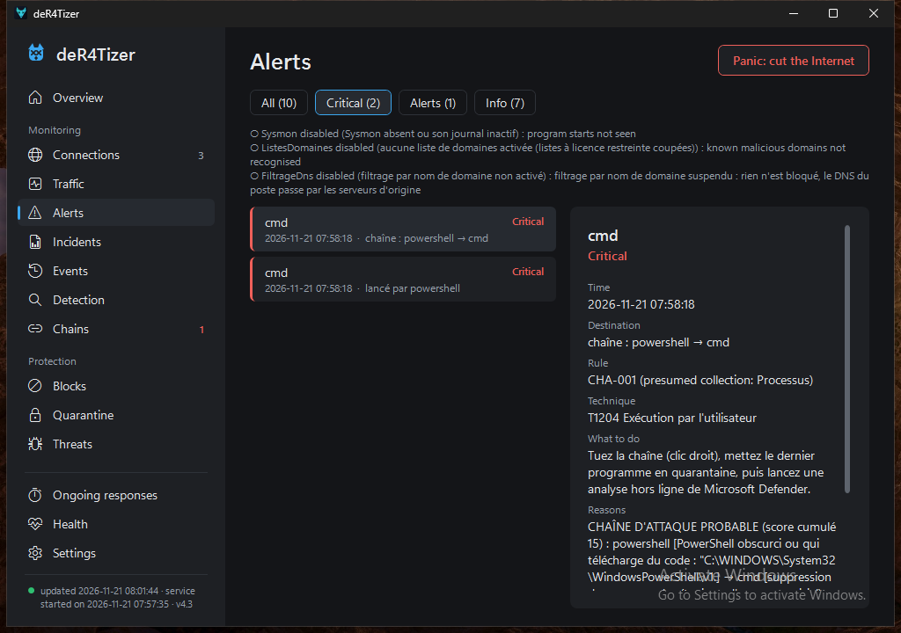

# deR4Tizer

**Local endpoint defense for Windows: EDR-style detection, a mini-SIEM and hardening; no cloud, no telemetry.**

> ⚠️ **Proof of concept.** Under active development, not audited. Does not replace an antivirus or a commercial EDR.
>
> The interface is bilingual (English / French); this README and the project site are in English.

---


### Why

deR4Tizer targets organisations with neither a SOC nor an EDR budget: small municipalities, micro-businesses, craftspeople, shops. Everything runs **on the endpoint**, with no account, no cloud and no telemetry. Critical alerts reach the IT provider or contact person (ntfy, Teams, e-mail) and can also go to the SIEM of your choice.

### Screenshots

Real screenshots of the current interface (v4.3, 2026-11-21), taken in the test VM by `tests/vm/captures.ps1`:
Windows 11 (not activated, hence the watermark), Microsoft Defender on, service installed from the MSI and left
running for a few minutes, after a harmless demo attack (an encoded PowerShell that only waits, and a command line
that carries a backup-deletion command without running it). No data from a real computer. Some texts that come from
the service (rule details, advice, reasons) are still in French in the English interface. The 12% of security
settings applied is the VM's real state: the security baseline was not applied there.





### Features (v4.3)

Actual state of each capability (validated on Windows by the CI, checked in a test VM, lab-tested, or implemented without verification; the CI was disabled from 2026-10-22 to 2026-11-17):
[capability matrix](docs/roadmap/capability-matrix.md). None is production-ready yet; NDR, DPI and
IDS/IPS are experimental and under validation in the Kali lab campaign (reports in [docs/validation/](docs/validation/)).

| Area | What deR4Tizer does |
|---|---|
| **Network** | Live outbound connections per program, suspicion score, beaconing detection, first Internet connection of a program |
| **Threat intelligence** | Open-source lists refreshed every 12 h (the two Spamhaus DROP lists every 24 h, as Spamhaus asks); automatic firewall blocking, on by default and can be turned off, for three lists only: Spamhaus DROP IPv4, Spamhaus DROP IPv6 and Feodo Tracker, at most 30 per hour; other lists only raise an alert |
| **Processes** | Process tree with cumulative chain score, obfuscated PowerShell, MITRE ATT&CK techniques; without Sysmon, process creations are read from the Security log (event 4688), so short-lived programs are seen with their command line and their parent (WMI only when this audit is off, which the Health page states) |
| **Persistence** | Run keys, services, scheduled tasks, WMI, Startup folders: alert on any new or changed entry |
| **Ransomware** | Canary files, automatic suspension of the program touching them; alert only if it is known, signed software with its exact name, installed in a folder that only SYSTEM, Administrators, TrustedInstaller or services can write to or own (permissions checked) and running as SYSTEM or an elevated administrator, if an administrator resumed it (7 days, same file), or after 3 suspensions in 24 h of such a signed program installed in Program Files (script hosts excluded). Sync clients running under the user's account (OneDrive, Dropbox, Box), and software whose folder is owned by the account that installed it, are suspended if they touch a canary file |
| **Data theft** | Access auditing on sensitive browser and application folders |
| **Privacy** | Camera, microphone, remote-control tools, open ports |
| **Firewall** | Rule-change tracking (with the authoring program), Internet exposure (inbound packets from public IPs); when no exposure is found, each check is reported as seen or not checked (packet log off, UPnP not checked: "checks incomplete"), never "no exposure"; per-check diagnostic (public IPv4, global IPv6, accepted connections, blocked sources, UPnP, Windows Firewall) and a verdict: "computer exposed" (red) only for proven exposure, "exposure to watch" (orange, e.g. a global IPv6 address alone), "nothing found" or "checks incomplete", never "protected" |
| **Hardening** | Baseline inspired by Intune and Microsoft, applied through local Group Policy, reversible; a Defender rule counts as compliant only when Defender actually applies it ("no effect" when Defender is not the active antivirus or applies another value); side effects (Remote Desktop, UAC prompts, guest shares) are stated before applying, and the full profile leaves Remote Desktop on when it is in use; LSA protection without the UEFI lock (Windows 11 22H2 or later), so it stays reversible; event logs are never shrunk; reverting restores the original values, checked rule by rule in a test VM (60 rules) |
| **Response** | Kill, suspend, network-isolate (on the program's real path; a link, junction or mount point in the path is refused, and the administrator gives the real path), quarantine, PANIC button (cuts Internet, set in full or not at all, real state checked on the firewall); process identity re-checked just before the action; a suspension, an isolation or panic mode are never lifted automatically, but raised again to the IT provider at their deadline, as are a quarantine (30 days) and a manual block (90 days); automatic actions go through a loop guard that never holds back the alert, and an address unblocked by hand is not blocked again for 7 days |
| **Mini-SIEM** | Normalised events (logons, accounts, groups, processes, services, connections, firewall, alerts) kept 30 days, search, timeline, correlation incidents (brute force, logon after failures, new administrator, log cleared, suspicious service, weakened protection, multi-stage attack, access from the Internet) |
| **Incident tracking** | Alerts attached to incidents: open, in progress, closed with a reason, never closed automatically; timeline per incident (alerts, events, response actions, collection gaps); Incidents page in the interface |
| **Health** | Collections, alert forwarding, interface and the response register (`reponses.json`: write failing, or unreadable at startup so the session's deadlines would be lost on restart) monitored, with a finding when one stops; forwarding, when configured, retried after a failure; interface restarted by a scheduled task; Health page and header indicator |
| **Detection rules** | Each rule has an identifier and an entry in `docs/detection/regles.md`; most have a sheet: rationale, telemetry, expected false positives; "nothing suspicious" is told apart from "collection unavailable" |
| **Traffic analysis** | Passive packet capture (Windows raw sockets, no driver): throughput, programs, destinations, ports and countries (regional Internet registries), live world map |
| **Local NDR** (experimental; lab-tested in the Kali campaign, except the rogue DHCP server, to be measured again after a fix) | Gateway ARP spoofing, new devices, rogue DHCP server, LLMNR/NBNS/mDNS poisoning (Responder) with an active decoy; also works behind a VPN |
| **DPI** (experimental, not yet measured in the campaign) | TLS site names (SNI) and JA3 fingerprints (SSLBL list), cleartext HTTP (credentials sent unencrypted), DNS (DNS tunnelling), SMB/Telnet/FTP to the Internet, names checked against threat lists |
| **IDS / IPS** (experimental; in the Kali campaign only the built-in test rule was exercised, IPS mode not exercised) | Suricata-format rules (subset: content, nocase, offset/depth/distance/within, flags, dsize…), built-in rules + `.rules` files (e.g. Emerging Threats Open); IPS mode blocks at the firewall |
| **Alert forwarding** | To the IT provider or contact person: ntfy, Microsoft Teams (workflow webhook, card with the "what to do"), encrypted SMTP e-mail; alert grouping, hourly cap, secrets restricted to administrators |
| **Integration** | Syslog RFC 5424 (UDP/TCP, JSON or CEF, cleartext), read-only HTTP export API with token |
| **Privacy** | Data (events, sessions, alerts, devices) readable only by SYSTEM, administrators and authorised accounts; API token restricted to administrators; folder created with its permissions by the installer, owner and permissions enforced and checked at every start, files owned by anyone else ignored; if the check fails, settings and secrets are ignored and the interface shows it |
| **Less noise** | 7-day learning mode (behaviours remembered), "no longer alert for this behaviour" exceptions (keyed on the rule and the behaviour, never on ATT&CK labels; exceptions from an older format are counted in the Health page), "direct IP" criterion neutralised for known VPNs, messengers and games; critical alerts are never softened |
| **Updates** | Daily check; installation (off by default) only with a correct SHA-256 hash and a signature by one of the keys pinned in the binary, whole-chain revocation checked, with an unreachable, unknown, or revoked list making the install fail closed, files kept in a SYSTEM-only folder, with rollback if the service stops answering (Windows validation in progress) |
| **Interface** | French / English: automatic (follows the Windows display language of the user, the default), French or English, set per user in Settings without administrator rights and applied the next time the interface starts (the page says so); a French choice saved by an earlier version is not kept on a non-French Windows (choose it again in Settings); the elevated helper window uses the language of the interface that opened it; texts produced by the service are still in French (inventory in `docs/architecture/langue.md`, in French; lab-tested, not yet checked in a VM session); "Ongoing responses" page: every lasting action (suspension, isolation, panic mode, quarantine, manual block), its reminder deadline and how to recover it; panic mode states its scope before acting and its real state afterwards; keyboard-navigable (lists, the events timeline and the process-chain tree take focus, arrow keys and Enter / Space), with screen-reader names and a high-contrast mode (not yet verified with a screen reader); lists label risk in plain words rather than a raw score |

### Architecture

```
deR4TizerSvc.exe   Rust Windows service, SYSTEM account (monitoring, response, export)
deR4Tizer.exe      C# interface (.NET Framework 4.8, ships with Windows), no admin rights
C:\ProgramData\deR4Tizer   shared state (JSON), log; readable by administrators and authorised accounts
\\.\pipe\deR4Tizer         interface → service commands (Administrators and SYSTEM only, on this computer: remote connections refused)
```

No kernel driver and nothing extra to install: only Windows APIs (ETW, Event Log, WMI, Firewall, IP Helper, WinVerifyTrust).

### Build

Requirements: Windows 10/11, Visual Studio Build Tools 2022 ("Desktop development with C++" workload), [rustup](https://rustup.rs) with the **stable-x86_64-pc-windows-msvc** toolchain. The CI uses the exact version pinned in `service-rs/rust-toolchain.toml` (1.100.0) and builds with `--locked`; `compiler-rs.ps1` names `stable-x86_64-pc-windows-msvc` explicitly, which takes precedence over that file. Tests on a machine use the artifact built by the CI.

```powershell
rustup toolchain install stable-x86_64-pc-windows-msvc
.\compiler.ps1          # interface (Windows csc) + Rust service → bin\
```

### Install

Download `deR4Tizer.msi` from the [releases page](https://github.com/cryptobones-1337/deR4Tizer/releases) (first
signed release: v4.3, 2026-11-23) and open it. The service starts immediately; the interface starts on its own, without administrator rights, within the next few minutes (restart task), then at every sign-in; the installer does not start it. It is also in the Start menu. Installer license and texts in French and English. New versions are reported;
automatic installation can be turned on in the settings (signed releases).

Fleet deployment (GPO, Intune, IT provider): `msiexec /i deR4Tizer.msi /qn` (`LANCEMENT_SESSION=0`, kept across updates, to skip the scheduled task that restarts the interface and the logon
launch). Uninstall from "Apps" or with `msiexec /x deR4Tizer.msi /qn`: blocks, firewall rules, canaries and the read
auditing set on browser and wallet folders in user profiles are removed, original security settings restored and data
deleted (`GARDER_BASELINE=1`, `GARDER_DONNEES=1` keep them), except a quarantine that is not empty: the quarantined
copies (`C:\ProgramData\deR4Tizer\quarantaine\`, encoded, never runnable as they are, except copies made before
v4.3 and never converted since, which the report then names as stored in clear), their index `quarantaine.json`
and the marker `prise-en-charge.json` are kept, reserved to SYSTEM and administrators, because they may be the only copy
of a file you want back: reinstall deR4Tizer to restore them from the Quarantine page. The uninstall says so in
`%SystemRoot%\Temp\deR4Tizer-desinstallation-*.txt` and in the Application event log. To delete them, in an
administrator command prompt: `rmdir /s /q "C:\ProgramData\deR4Tizer\quarantaine"`, then
`del "C:\ProgramData\deR4Tizer\quarantaine.json" "C:\ProgramData\deR4Tizer\prise-en-charge.json"`. If one of them
is not owned by SYSTEM or Administrators (it is never taken over), has more than one name (hard link), or its
permissions cannot be made and checked reserved to SYSTEM and administrators, they are all deleted with the rest, and
the report says so (audit of 2026-11-23, A-4-3).
The data folder itself (`C:\ProgramData\deR4Tizer`) stays, reserved to SYSTEM and administrators (empty, or with the
kept quarantine only), so that a standard account cannot put a link in its place before a reinstall; delete it as an
administrator if you want it gone.
The installer refuses to install while `C:\ProgramData\deR4Tizer` is a link (junction or symbolic link).
With domain-name filtering on (phase 7), hardware Ethernet and Wi-Fi cards point to the deR4Tizer resolver (`127.0.0.1`,
`::1`), with their original servers as fallback; virtual cards (Hyper-V switches, WSL, Docker, VPN), recognised from
flags read from Windows and never from their name, are not changed. Turning it off, stopping the service and uninstalling restore their
original state (recorded in `filtrage-origine.json`, in the data folder). If a card were left on `127.0.0.1` (service
killed, manual rollback to a version without filtering), DNS still works through the fallback servers; to restore it by
hand, as administrator: `netsh interface ip set dns "<card>" dhcp` and `netsh interface ipv6 set dns "<card>" dhcp` (or
the original servers recorded in the file). Laptop limit: the fallback servers and the upstream are those of the network
where filtering was turned on; on another network, if they do not answer, filtering is suspended (cards restored) and
resumes when the upstream answers again. To follow a new network, turn filtering off and on again.
Repair (`msiexec /fa`) is restricted to administrators and hidden from "Apps": it stops and restarts the service
(the refusal for a standard account is checked by the integration scenario: same service process before and after).

Development: `.\construire-msi.ps1` builds the package (WiX 3.14, MS-RL licence, royalty-free); `.\mettre-a-jour.ps1`
replaces the executables of an existing installation.

### SIEM integration

**Syslog**: Settings → *Syslog*. JSON format (RFC 5424 header, JSON detail) or CEF.

**Export API**: Settings → *Export API*. Listens on `127.0.0.1:8642` by default. Local-network access is optional (Domain and Private profiles only).

```bash
curl -H "Authorization: Bearer <token>" "http://127.0.0.1:8642/api/v1/alertes?niveau=Alerte&format=ndjson"
```

| Route | Content |
|---|---|
| `/api/v1/sante` | Availability (no token) |
| `/api/v1/alertes?depuis=&niveau=&limite=&format=json\|ndjson\|cef` | Alerts |
| `/api/v1/connexions`, `/exposition` (with the per-check diagnostic: found, not found, not checked), `/baseline`, `/regles-parefeu`, `/blocages` | State |
| `/api/v1/evenements?q=&source=&type=&niveau=&depuis=&jusqua=&limite=&format=json\|ndjson` | Event search (mini-SIEM) |
| `/api/v1/incidents` | Correlation incidents |
| `/api/v1/etat` | Full service state (`etat.json`, the file the interface reads) |
| `/api/v1/journal?lignes=200` | Service log (text) |

### Automatic updates and signing

> **Known limit.** On versions 4.2 and 4.3 already installed, automatic updates install nothing: the install script,
> launched without a console, did not run (fixed by PR #26, included in the signed release v4.3). An installed 4.2 or 4.3 test build
> therefore does not update itself: uninstall the test build first (`GARDER_DONNEES=1` keeps the data), then install the
> signed v4.3 by hand (`msiexec /i deR4Tizer.msi`); automatic updates then work from that one onward. Uninstalling first
> is a precaution: both carry version 4.3.0, and installing the signed package directly over a test build has not been
> checked yet.

Each `vX.Y` tag triggers the *Publication* workflow: tests, build, signing, hashes and `manifeste.json` attached to the
GitHub release. Machines read this manifest once a day (`releases/latest/download/manifeste.json`); after a failed read
they try again after 15 min, then 1 h, then daily (a 404 reads "manifeste introuvable (404)"), and a check failing for
24 h or more shows as "to check" on the Health page, as does a manifest **older than the installed version** (a replaced
manifest could freeze updates; it used to read "up to date"; audit of 2026-11-23, A-3-2 and T-12, unit-tested; scenario
for the older manifest added to the CI update job). The manifest is
strict (known fields only, 64 KB at most, a single file: the MSI package) and is never authoritative on its own, since
it is not signed. Automatic installation is off by default; when on, it installs a package only if its hash is the one
in the manifest, if it is signed by one of the **keys pinned in the binary** (SHA-256 hashes of the public keys, repo
variable `CLE_SIGNATURE`, passed to the build as `DER4TIZER_CLES_SIGNATURE`: the current key and the next one,
comma-separated, to get through certificate renewal; v4.3 pins only the current key, the next one must be pinned in a
release published before the certificate expires on 2027-11-17), with revocation checked, and if the **version read from the
signed package** (`ProductVersion`, with deR4Tizer's `UpgradeCode`) is the one in the manifest and strictly newer than
the installed version. Before any installation, the service also fetches the package of **its own version**, verified
the same way, so it can roll back; without it, nothing is installed. The files are kept in `%ProgramFiles%\deR4Tizer\maj`,
reserved to SYSTEM (permissions checked before each use), and the hashes are re-checked just before execution. The
service must then answer with valid JSON on its channel, with the new version, within 60 s; otherwise the previous
version's package is reinstalled. Without a pinned key, a version is only reported: a compromised GitHub account is not
enough to run a binary as SYSTEM across the fleet. The health check also verifies that the channel's pipe is held by the
service process (and not by a program that created it while the old version was stopped).

**First deployment.** The first signed version is v4.3 (2026-11-23). Machines installed before it have
neither a pinned key nor a rollback package available: they will never update on their own. The fleet therefore starts
from a first signed version, installed by hand (or by GPO, Intune, IT provider). Release procedure:

1. obtain the code-signing certificate and compute the SHA-256 hash of its public key;
2. set it in the repo variable `CLE_SIGNATURE` (later, together with the next key's);
3. place the certificate in the GitHub "publication" environment (approval required);
4. push the `vX.Y` tag matching the code version: CI builds, signs, builds the MSI and publishes the release with its
   manifest, but only after checking that the MSI and both executables carry a valid, timestamped signature from a key
   in `CLE_SIGNATURE`, whose certificate chain builds with no error and whose revocation is checked online
   (`verifier-signatures.ps1`, run by the CI on real test packages: unsigned, other key, revoked, unreachable
   revocation list, no timestamp, accepted); otherwise nothing is published (so, while signing is done on the
   maintainer's computer, a tag alone publishes nothing);
   with the current certificate (Certum, key kept in SimplySign, not exportable), signing is done locally:
   `signer-version.ps1` downloads the CI's unsigned "a-signer" artifact for the tag (its SHA-256 checked against the
   one GitHub reports), checks that the certificate's key is the one compiled into the service, signs both executables, builds and signs the MSI from the tag's sources, writes the manifest,
   runs `verifier-signatures.ps1`, checks the MSI version, then creates a draft release that the maintainer reviews and
   publishes by hand; it stops at the first failed check (`docs/publication/signature-locale.md`);
5. install this MSI on each machine; later versions can then install on their own (if automatic installation is on),
   this first version's package serving as the rollback.

Protect releases: keep the signing secrets in the GitHub "publication" environment with a required approval (Settings ›
Environments), protect the `v*` tags (Settings › Rules). The build (where the dependencies' scripts run) happens in a
job with no secret; signing, in a separate job that receives only the executables; the WiX archive is verified by its
hash and the actions are pinned by SHA. The certificate chosen (Certum Open Source, 2026-11-11) keeps its key in Certum's cloud (SimplySign): it never enters GitHub, and signing is done on the maintainer's own computer.

With a certificate in .pfx format instead, the signing job of the workflow uses the secrets `CERTIFICAT_PFX` (.pfx file
in base64) and `CERTIFICAT_MOT_DE_PASSE`; it is not used with the Certum certificate. SignPath Foundation and Azure
Trusted Signing were set aside: not suitable as-is for automatic updates (see `docs/security/threat-model.md`). Locally, `DER4TIZER_CERT_SHA1` (the hash of a certificate in the store) makes
`compiler.ps1` sign. Until the binaries are signed, Windows shows "unknown publisher" and machines report new versions
without installing them.

### Known limits

Known, by design. Be aware before relying on it:

- A PC on a switched network sees only its own traffic, broadcast and multicast: this is not a whole-network NDR (a mirror port would be needed).
- The "deR4Tizer capture" firewall rule allows all inbound to the service: it is necessary, because a rule blocking inbound TCP to the service also breaks capture (measured: 3 KB received in 20 s instead of 304 KB). The service listens on no network port, except the optional API, filtered by address and blocked on the Public profile.
- IPv4 capture only for now; the country is that of the address-block holder (a CDN may appear in the United States).
- Since v4.3 (2026-11-23), the released executables and MSI are signed (Certum). Builds installed by hand before it are unsigned: Windows shows "unknown publisher" for them and they do not update on their own. The service recognises its own files by their SHA-256 hash.
- The license text shown by the v4.3 installer still says the binaries are not signed: wrong for v4.3, to be corrected in the next version.
- v4.3 was published before the deferred D4-1 trials (maintainer's decision, 2026-11-23): restarting the interface in a Remote Desktop session and on fast user switching has not been exercised yet.
- v4.3 was also published without an independent review: the reviews of 17 and 21 November 2026 and the audit of 23 November 2026 were done by Claude (another agent, without the development history), which does not meet the project's own condition (a person or organisation other than Claude); and without the planned trial of revocation checking once the certificate has expired (maintainer's decision, 2026-11-23).
- deR4Tizer complements Microsoft Defender, it does not replace it: an administrator-level attacker can stop the service.
- Data-theft detection relies on the identity of the program reading the files: it does not see code injection inside the browser. Launching a browser in remote-debugging mode (`--remote-debugging-port`, a common cookie-theft technique) is, however, flagged.
- On a managed device (domain, Intune), or when that cannot be checked, the baseline is read-only; if the organisation does not enable file-system auditing, a badge signals that data theft is not monitored.
- IDS rules using `pcre`, `byte_test` and a few other options, or a header variable that is not one of the standard address and port variables of Suricata 7's default `suricata.yaml` (taken with their default values), are ignored and counted rather than mis-applied.
- Syslog export is sent in cleartext (UDP or TCP, no TLS): keep it to a trusted local network.
- The export API is plain HTTP: when it is opened to the local network, its token and data travel in cleartext, like syslog.
- Export API connections (audit of 23 November 2026, A-1-3, tested in the lab, not yet tried in the VM): 16 at most. When the API is opened to the local network, connections from the computer itself (loopback, or the computer connecting to its own network address) get 4 of them only, so a local program going that way can no longer take the SIEM's places (a connection from another of the computer's own addresses, on a machine with several network cards, is not recognised); refusals for lack of room are logged and written to the SIEM once every 10 minutes. When the API listens on 127.0.0.1 only, every client, the SIEM included, is local: a program of any account that keeps reopening 16 silent connections still makes the export unavailable (signalled, no leak, no elevation).
- If the data folder's protection fails at start-up, a critical alert stays local: forwarding secrets are ignored, so your IT provider is not notified.
- If the data folder's root is a link that cannot be removed (a junction held open by another account, audit of 2026-11-23, C-1), the service writes nothing in or under it: it says so in the Windows event log (Application log, source `deR4Tizer`, without a registered message file) and in a report in `%SystemRoot%\Temp`, does not start monitoring, and retries every minute. While it waits, the interface cannot reach the service and shows no alert. Tested on the decisions and in a CI scenario; to be replayed in the VM.
- `config.json` (and any data file read the same way) present but unreadable or malformed is no longer taken for absent (C-3): the default configuration is used, the file is never rewritten until the next start, settings commands are refused, the Health page says so and SAN-014 is raised. Fix or remove the file, then restart the service.
- Uninstall leftovers (audit of 2026-11-23, A-4-3 and A-6-4; tested on the decisions and in CI scenarios, to be tried in
  the VM): a quarantine that is not empty is kept (see Install). The read auditing set on profile folders is removed
  through handles that follow no link, entry by entry: only entries identical to deR4Tizer's (Everyone, success, read
  data, same inheritance flags) go, together with the copies Windows makes of them on files and subfolders created
  after deR4Tizer set them (`(AU;SA;CC;;;WD)` on a file, `(AU;OICISA;CC;;;WD)` on a subfolder, or the same with the
  inherited flag `ID`), copies being removed only under a folder that no longer passes them on; so an identical entry
  set by someone else on the same folders or their content goes too (an audit list does not record who added an
  entry), and every other entry stays; items that cannot be opened (links,
  unreadable, beyond 20,000 per folder) or whose audit list holds a conditional or resource-attribute entry (never
  rewritten) keep it, and the uninstall report gives their number. Left on purpose: the reports of the uninstall
  itself (`%SystemRoot%\Temp\deR4Tizer-nettoyage-*.txt`, `deR4Tizer-arret-*.txt` if stopping the service was slow,
  and `deR4Tizer-desinstallation-*.txt` when the quarantine is kept or a deletion failed; older deR4Tizer reports
  there are removed, only those written by SYSTEM, with a single name and at least one hour old), and any `C:\ProgramData\deR4Tizer.ecarte-*` folder, where
  the service moved a data folder that did not belong to SYSTEM or administrators: its content belongs to another
  account and may be evidence, so it is never deleted; check it and delete it yourself.
- The MSI accepts an older version (needed to roll back): the service refuses an older version for automatic updates, but an administrator can still install one by hand.
- The installer's check that the data folder is not a link is a small read-only JScript action: on a computer where Windows Installer cannot run scripts, installation is refused (fail-closed). The check is done before installing; a link put in place afterwards is handled by the service (see above).
- Batch 3d was measured in a test VM with Microsoft Defender fully active (with and without the hardened baseline):
  the installed product is not detected (no exclusion, scan and quick scan with no detection, service intact). A
  signal, not proof on a real machine. Batch 3d was passed again on the signed v4.3 MSI before its release
  (2026-11-23: all scenarios passed, no Defender detection).
- The interface has only been opened in the test VM (the screenshots above), never on a real production computer; the confirmation windows behind its buttons are not exercised by any scenario, and its decisions are tested separately.
- Known software is not suspended when it touches a canary, and its alert is at Info level. Since 2026-11-21 this also requires that the program and its folders cannot be written by standard accounts and that it runs as SYSTEM or with administrator rights; a hollowed process started from such a binary keeps this status.
- Canaries follow the real location of `Documents`, `Pictures` and `Desktop` (OneDrive folder backup, redirection to another local drive), read from the user's own registry while they are signed in. Outside the profile, only a folder on a local fixed drive (as seen by the service) and owned by the user is accepted; a canary that has more than one name (hard link) is neither audited nor watched. When the user is not signed in (registry not loaded), or the folder is redirected to a network share or a removable drive, the canary stays in the profile's default folder, so ransomware in the real folder is not caught by it (the refusal is logged; the health status shows "n placed out of m expected"). With OneDrive folder backup, canaries now sit in folders that OneDrive syncs: they may be uploaded to the user's OneDrive cloud storage and appear on the user's other devices, and OneDrive itself, running under the user's account, is suspended if it writes to or deletes a canary (Files On-Demand freeing space, sync conflict), which stops syncing until the user resumes it. None of this is tried in a VM yet (it needs a Microsoft account). The service now runs at normal priority, with heavy periodic work in background mode and the canary response above normal; the effect on the delay between the canary event and the suspension under load is not measured.
- Process rules read the command line only. A renamed copy of `powershell.exe` is recognised only with Sysmon (original file name of the program), not from event 4688 or WMI; obfuscation by string concatenation (`&('i'+'ex')`) is not seen; PowerShell script-block logging (event 4104) is turned on by the baseline but read by no rule. Process chains (CHA-001) do not see a parent chosen at process creation (parent process spoofing). A developer tool that starts PowerShell with `-EncodedCommand` raises PRC-002 at each start and one chain alert per session (at most 3 per chain and per hour unless a new technique or a strong signal appears, since the fix of the impossible chains found on 23 November 2026: reused process IDs, programs started by the service; tested in the lab, not yet tried in the VM). The forms missed by PRC-002 and PRC-005 and the chain cut by a fake `svchost.exe`, found by the audit of 23 November 2026, are fixed (tested in the lab, not yet tried in the VM). PRC-003 and PRC-005 now apply to the program actually launched (its image name, or with Sysmon its original file name) and to a tool started at the head of a `cmd /c` or `powershell -c` command, no longer to any text in a command line (false positive on `bash`, `git` or `grep` arguments, finding T-2, tested in the lab); a renamed copy of a tool is seen only with Sysmon.
- During the 7-day learning period, behaviours of a program already present are learned and later shown at Info level, with no end date; critical alerts and strong signals are never learned.
- The SIEM keeps the first 400 characters of every process command line, for all accounts, for 30 days, and process chains show command lines. Accounts allowed to read the data (by default the first account seen at the console, listed in Settings) can read them. Known secret arguments (`net use` and `net user` passwords, `/pass:`, `--password`, `-Password`, `-Credential`, `ConvertTo-SecureString`, `PGPASSWORD=`, `user:password@` in an address, and tool-specific forms such as `schtasks /rp`, `mysql -p…`, `plink -pw`, `sqlcmd -P`, `curl -u user:password`) are masked before anything is stored, shown or exported; a secret passed in another form, or to a tool not in the list, stays readable. Removing a reader account from the interface is not available yet.
- Baseline: the local Group Policy files (`Registry.pol`, `audit.csv`, `gpt.ini`) are read fail-closed since the audit of 2026-11-23 (A-2-2): a file held by another program, truncated or in a format not understood makes the baseline refuse to apply, cancel or uninstall, before anything is written, instead of erasing the other local policies; each file is written in one block without changing its permissions. Cancelling keeps a value that someone has changed or deleted since the baseline was applied, outside deR4Tizer (A-2-3): deR4Tizer's policy entry is removed and that value is set back as it was read before cancelling; if this fails, or if the current value cannot be read, the rule stays recorded as applied and the message says so. An `audit.csv` or `gpt.ini` not encoded in UTF-8, or with an audit subcategory line in an unexpected form, is refused, never rewritten. Tested on temporary files; to be checked in the VM. If the baseline cannot be cancelled during uninstall for this reason, its policies stay in place and, without `GARDER_DONNEES=1`, the rollback backup is deleted with the data: cancel the baseline in the interface before uninstalling, or uninstall with `GARDER_DONNEES=1` (fix planned).
- Any program running under your account can start deR4Tizer's elevated helper with a command of its choice: the confirmation window says what will be done, "Cancel" is the default button, and for a command that weakens protection (restart learning, turn a setting off, remove one or all blocks, resume a process, add an alert exception, turn panic mode or filtering off, change filtering categories or allowed domains, change syslog or API settings, allow an account to read the data, revert the baseline, restore from quarantine) it says at the top, in a red banner, that the request may not come from you and keeps "Continue" disabled for 2 seconds (1 second for other commands; the seconds left are shown on the button). The window has the dark theme and icon of the interface, a short title from a fixed list (never text taken from the command), and the full description in a dark read-only box, consequences as a list, that can be selected and copied; it grows with its text up to 70% of the screen, then scrolls. Its layout is tested by rendering it off-screen, not yet seen behind a real UAC prompt. Confirm only actions you asked for in deR4Tizer. Since the audit of 23 November 2026 (A-1-1, A-5-2), neither the elevated helper nor the service opens a network path (`\\host\...`, WebDAV, mapped drive): the helper accepts only its own command file in your local profile on a fixed drive, checked on the path text before any disk access, and the service (which still reads local USB sticks, CD-ROMs and RAM disks) treats a program on such a path, or on a path that goes through a link (symbolic link, junction), as unsigned without reading it, and refuses to quarantine a file on such a path (tested in the lab, to be tried in the VM on a domain-joined computer). Known gap: the signature itself is read by path after that check, so a folder swapped for a link in between would be followed.
- Install folder check (A-4-1, S277-01): the installer sets the permissions of the program folder (SYSTEM and Administrators full control, Users read and execute, inheritance cut). At start, the service reads, through handles that follow no link, the owner and permissions of that folder, of its two programs and of every parent folder up to the drive root: only SYSTEM, Administrators and TrustedInstaller may write, delete a child, or change permissions or owner (on the drive root, creating folders is allowed, as Windows does for Authenticated Users). Otherwise (for example a folder under `C:\Tools` that standard accounts can rename), or if the permissions cannot be read, it raises a critical local alert (INT-003) and refuses automatic updates. The default folder (Program Files) passes. Tested in the lab; an install redirected to another folder is to be tried in the VM.
- A standard account can reach the cap of 30 blocks per hour by connecting to 31 listed addresses: list blocking then stops
  for an hour, alerts remain. An IPS alert (experimental) says "blocked" even if the guard then holds the block back.
- Domain-name filtering (audit of 23 November 2026, tested in the lab, not yet tried in the VM): on a Hyper-V host whose
  physical card is bound to an external virtual switch, the computer's address is on a virtual card, so filtering
  cannot be turned on ("no hardware card"). The confirmation window does not list the cards that will be set yet (the
  service publishes the list, the window will show it in a later change). The resolution delay saved by no longer
  trying Windows' default `fec0:0:0:ffff::1` to `::3` servers has not been measured. Filtering is still suspended
  (cards restored) when the upstream really stops answering, including when an attacker cuts it on the network: this
  fail-open choice keeps DNS working; queries chosen by a local program alone no longer trigger it.
- Panic mode: the machine's DNS servers and the notification servers stay reachable for every program (malware could use
  them to send data out, for example through DNS); prefer a self-hosted ntfy server to ntfy.sh.
- Traces stay on the monitored machine (SIEM: 30 days and 1 GB at most): an administrator can erase them, and an intrusion
  found late may have aged out. A standard account that generates many events no longer pushes previous days out, but
  it can fill the current day (1 GB / 30): further events of that day are counted and not written, and a health
  finding (SAN-013) says so, as it does for dropped events. The service log keeps 5 previous files of 2 MB. No
  encrypted and complete export exists (`docs/security/threat-model.md`).

### Roadmap

1. ✅ Settings, FR/EN language, syslog, export API
2. ✅ Local mini-SIEM: storage, search, timeline, correlation
3. ✅ Traffic analysis, per-country geolocation (public RIR data), world map
4. 🧪 Local NDR (experimental, being validated): ARP spoofing, rogue DHCP server (not yet measured positive in the lab), LLMNR/NBNS/mDNS poisoning
5. 🧪 DPI and IDS/IPS (experimental, being validated): SNI, DNS, JA3 fingerprints, Suricata-compatible rules
6. ✅ Identified and documented detection rules, collection status (phase 3)
7. ✅ Incident tracking, timeline, health of collections and interface (phase 4)
8. ✅ Response bounded by the policy: identity re-checked, loop guard, deadlines (phase 6)
9. ✅ Interface redesign (WPF) and first-run assistant; the new interface is the default interface; the previous interface remains available with `deR4Tizer.exe --classique` (contents: Overview of the computer's status, with a "Protections" panel that shows, for each protection feature, the state the service publishes (active and verified, off by choice, on without effect or recommended and off, information, not verifiable when the service does not publish it), one link per line to the feature's page where it is turned on with the same confirmation, no "turn everything on" button and no overall verdict; critical incidents still open and critical alerts not yet read are counted as issues to act on, with the same number as their tiles; panic button, Connections (suspicious count at the same threshold as the Suspicious tab), Traffic (country map and throughput; traffic with no program shown as "Unidentified program" with the reasons the service publishes), Alerts, Incidents, Events, Detection, Chains, Blocks, Quarantine, Threats, Baseline, Firewall, Autostart, Extensions, Privacy, Local network, Ongoing responses, Health and Settings pages with a details panel; the Settings page shows one section at a time (language and first-run setup, learning, alert forwarding, syslog, export API, updates, accounts and data), each with a short status in the section list (learning day, channels on, update check from the code the service writes in `maj.json`), one card per block, an on/off switch per alert channel, input errors under the field and destructive actions set apart in red with their consequence; saved secrets are never shown again, the empty field only says whether one is saved; the commands sent are the same as before; every page is now native; « First-run setup »: six steps (welcome, check, learning, who to notify, automatic responses, summary) offered the first time the shell opens and available again from Settings; learning can be ended, automatic responses turned on or off and a test message sent to the alert channels already set up there, each change confirmed by an administrator; at sign-in, the interface stays in the notification area without a window; deR4Tizer in the Start menu shows the interface already running; if the new interface cannot start, the classic interface replaces it and says so). Still to do in this phase: B3 (last MSI page), B4 (lighter background mode) and U8b (installer images); B2 (second instance) is in the code, not yet exercised in the VM; see `docs/roadmap/interface.md`
10. 🔄 Domain-name filtering (phase 7, in progress): a DNS server change on one of the computer's network cards is reported (DNS-002); filtering can be turned on by an administrator from the "Browsing" page of the interface (state, categories, lists and licenses, last blocked names, "Allow this domain"), off by default; "ads and tracking" lists (EasyPrivacy, EasyList), no security list yet; upstream resolver of your choice, offered when turning filtering on: your network's (default) or Quad9 (Swiss foundation, blocks malicious domains; queries that are not blocked are then sent to it, local names included: on a company network, keep your network's), falling back to your network's DNS behind a captive portal

11. 🔄 Attack campaign (since 15 November 2026): ATT&CK scenarios run from a Kali VM against a test VM in a closed lab, network detection included (NDR, IDS); each batch is published in [docs/validation/](docs/validation/) (in French), with results for configuration A (no baseline) and configuration C (reinforced baseline). Local NDR: ARP spoofing, active LLMNR/NBNS decoy, passive LLMNR/NBNS/mDNS responders and UPnP redirection detected in the lab; rogue DHCP server to be measured again after a fix (#190). IDS: built-in test rule detected end to end; IPS mode, directional and content rules not yet exercised. Network decoders fuzzed on verbatim copies in a separate harness (about 151 million calls, no crash). DPI: not yet measured. "Lab-tested" here never means "validated".

"✅" means delivered in the code, not validated for production: see the capability matrix.

### License

[EUPL-1.2](LICENSE) (European Union Public Licence).

---

## Threat-intelligence credits

By default only lists whose terms allow any use are enabled (Spamhaus DROP, abuse.ch Feodo Tracker / SSLBL). The others
(FireHOL level 1, which aggregates DShield, ThreatView, Emerging Threats, CINS Army, IPsum, Phishing Army under CC BY-NC 4.0)
are non-commercial or unverified and must be enabled explicitly, for personal use. Lists are fetched over HTTPS only,
capped at 100 MB, rejected when empty or collapsing, and ignored when covering more than 134 million addresses; private,
CGNAT, link-local and multicast networks are never flagged or blocked.

Spamhaus DROP · FireHOL level 1 · abuse.ch Feodo Tracker and SSLBL (JA3) · ThreatView · Emerging Threats · CINS Army · IPsum · Phishing Army · LOLDrivers.
Geolocation: "delegated" statistics from ARIN, RIPE NCC, APNIC, LACNIC and AFRINIC. Map: Natural Earth 1:110m (public domain).
These lists belong to their authors and remain subject to their own terms of use.
